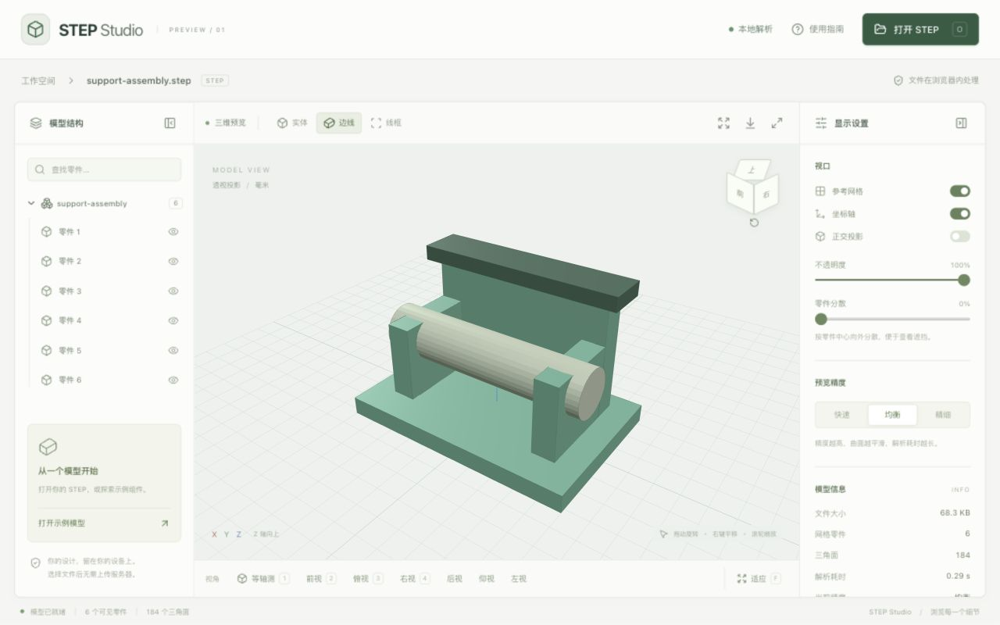

# STEP Studio

读取真实 STEP / STP 文件的三维预览基础框架。一套 React + TypeScript + Three.js 界面，既可在本机浏览器中运行，也可构建为静态网站。OpenCascade WebAssembly 在浏览器的独立 Worker 中解析文件，不需要上传用户选择的模型。



## 现在可以做什么

- 选择或拖放一个 `.step` / `.stp` 文件，文件上限暂设 100 MB。
- 鼠标左键旋转、右键平移、滚轮缩放；支持触控双指操作。
- 等轴测及前、后、左、右、上、下标准视图；一键适应窗口。
- 透视 / 正交投影；实体、实体带边线、三角网格线框显示。
- 零件搜索、单击选择、高亮、逐个显隐及显示全部。
- 参考网格、坐标轴、不透明度、零件向外分散。
- 快速 / 均衡 / 精细三档网格精度，可重新解析当前文件。
- 显示网格零件数、三角面数、解析时间、整体包围盒尺寸。
- 导出当前三维视口的 PNG 截图。截图包含模型和网格，不包含面板。
- 取消解析、120 秒解析超时、错误反馈及 GPU 资源清理。

首次打开会加载项目自带的 `support-assembly.step`：6 个真实 B-rep 实体，整体尺寸 **130 × 84 × 82 mm**。这个教学模型由项目脚本生成，横轴由 32 个平面围成，不代表精确圆柱曲面；普通 STEP 曲面由 OCCT 按预览精度生成网格。

## 本机启动

当前这台 Mac 已安装项目依赖，可双击 **`启动预览.command`**。它优先使用系统 Node，也兼容这台机器现有的 Codex Node 运行时。终端需要保持打开，按 `Ctrl+C` 停止服务。

其他电脑建议安装 **Node.js 22.12+**（或 20.19+）后运行：

```bash
cd step-studio
npm install
npm run dev
```

打开终端给出的本机地址，一般为 `http://127.0.0.1:5173`。若端口占用，Vite 会打印实际端口。项目同时包含 `pnpm-lock.yaml`；也可使用 pnpm 11 执行 `pnpm install` 与 `pnpm dev`。

默认只监听本机地址。要让同一局域网的设备访问，显式运行 `npm run dev -- --host 0.0.0.0`，并通过电脑局域网 IP 访问。

> 请通过 HTTP 服务打开。双击 `index.html` 使用 `file://` 不支持 Worker / WASM 的正常加载。

## 网页部署与离线本机运行

```bash
npm run build
npm run preview
```

`dist/` 是完整静态网站，包含解析器 JS / WASM 和示例文件；部署到 Nginx、对象存储、GitHub Pages 或其他静态托管平台即可。需要发布的是整个 `dist/`，其中较大的 `vendor/occt-import-js.wasm` 文件不能遗漏。构建脚本会从 npm 包自动复制解析器，运行时不依赖第三方 CDN。

生产环境须能正确返回 `.wasm` 文件，建议 Content-Type 为 `application/wasm`。应用采用相对资源路径，支持放在站点子目录中。Worker 从同源加载；如果站点设置 CSP，需允许同源 Worker、脚本和 WebAssembly 编译。

### GitHub Pages

站点地址：[STEP Studio 网页预览](https://line-ar-line.github.io/step-studio/)。

源码和部署统一使用公开仓库 `line-ar-line/step-studio`。站点发布 `dist/` 网页构建产物，用户打开的 STEP 文件在浏览器本地处理；随站点提供的只有项目自带示例。

仓库的 Pages 发布源设置为 **Deploy from a branch → gh-pages → / (root)**。更新网页时在本机运行：

```bash
npm run deploy:pages
```

发布脚本会检查 TypeScript、按 `/step-studio/` 子路径构建，核对 Worker / WASM / 示例资源，然后在临时克隆中更新 `gh-pages` 分支。GitHub Pages 检测到分支更新后自动发布。脚本复用本机 Git 登录，不需要额外部署密钥。首次在其他电脑发布前，需先配置好 GitHub 的 Git 推送权限。

本地复现 Pages 路径构建：

```bash
pnpm run build --base /step-studio/
```

只想离线在本机使用构建结果，也可以在项目目录运行：

```bash
python3 -m http.server 4173 --bind 127.0.0.1 --directory dist
```

随后打开 `http://127.0.0.1:4173`。本机文件与解析器齐全时，可以断开外网使用。在线网站的首次访问仍需下载应用资源；目前未加入 Service Worker，不承诺网页关闭后可离线重新访问。

## 本地、网页和桌面端的边界

| 目标 | 实现方式 | 当前状态 |
| --- | --- | --- |
| 本机预览 | 本机 HTTP 服务 + 浏览器 | 已实现，模型在本机解析 |
| 网页预览 | GitHub Pages 托管 `dist/`，浏览器选择本地文件 | 已配置 Pages 发布，见上方站点链接 |
| 独立桌面软件 | Tauri / Electron 包装当前界面 | 后续扩展，需要额外实现文件关联、安装包和平台测试 |
| 大型装配体在线预览 | 服务端 OCCT / FreeCAD 转换为 GLB，再由网页加载 | 后续扩展，当前没有转换服务器 |

建议先用这个纯前端版本验证你常用的 STEP 文件。对大型装配体，再加转换服务与 GLB 缓存；桌面安装包则可以复用当前界面与三维视口。

## 架构与扩展入口

```text
浏览器选择 STEP 文件
  → ArrayBuffer 转交一次性 Worker
  → OpenCascade WASM 读取 B-rep 并三角化（输出毫米）
  → Float32Array / Uint32Array 以 transferable 传回主线程
  → Three.js BufferGeometry、相机与 OrbitControls
  → React 展示元数据与控制项
```

```text
src/
  App.tsx                    操作界面、文件状态、快捷键
  types.ts                   模型、网格、元数据类型
  lib/import-step.ts         文件检查、Worker 生命周期、取消及超时
  components/Viewport.tsx    React 与 Three.js 的连接层（按需加载）
  viewer/StepViewer.ts       渲染、视角、选中、显隐、截图与资源释放
  styles.css                 布局与响应式样式
public/
  step-worker.js             OCCT 初始化与 STEP 解析
  vendor/                    安装 / 启动 / 构建时自动复制，不纳入版本控制
  samples/                   可直接使用的真实 STEP 示例
scripts/
  copy-occt.mjs               复制 WASM 和胶水 JS
  deploy-pages.mjs            构建网页并推送 gh-pages 发布分支
  generate_sample.py         可重复生成示例几何
tests/
  step-import.test.mjs        真实 OCCT 解析集成测试
```

三维渲染循环不经过 React state，仅在相机或画面变化时重绘，静止时不持续渲染。每次导入结束或取消时释放 Worker 和 WASM 堆，替换模型时销毁旧 GPU 几何及材质。

模型数据保留解析器返回的 `root` 结构；当前界面按网格零件平铺，未完整展现多级 CAD 装配树。若解析器没有提供零件名，会显示“零件 1”等回退名称。零件向外分散用于查看遮挡，不是装配约束求解或工程爆炸图。

建议后续依次增加：

1. 剖切平面与截面预览：在 `StepViewer.ts` 增加 clipping plane 与控制组件。
2. 点、边、面拾取：利用解析结果中的 B-rep 面到三角面映射。
3. 距离、角度和标注：预览网格可做近似测量；工程级测量需保留精确 B-rep 并接入几何计算。
4. 多级装配树、属性及模型管理：扩展 `ModelNode` 和元数据，不把网格数当作设计 BOM。
5. GLB 导出 / 转换缓存 / 服务端任务：让大型装配体按需加载，减少浏览器内存压力。
6. Tauri 桌面封装：复用前端，接入原生文件打开与 `.step` 文件关联。

## 验证与已知限制

```bash
npm test
npm run build
```

集成测试实际调用 OCCT 验证生成 STEP 的实体网格、颜色、尺寸、单位换算及损坏输入。示例文件和浏览器交互已经用于本机验证；其他 CAD 软件导出的 AP203 / AP214 / AP242 文件及大型装配体，仍需用你的实际样本继续兼容性测试。

- 当前是三维**预览框架**，不提供参数化 CAD 编辑或修改后重新导出 STEP。
- 内部渲染的是三角网格；包围盒基于网格，不能替代精密计量。线框显示三角网格；边线模式按网格夹角提取轮廓，未完整恢复所有原始 CAD 拓扑边。
- 文件上限 100 MB 是输入限制，不代表 100 MB 模型一定能流畅预览。STEP 解码、三角化和 WebGL 显存开销都可能远大于原文件，复杂装配体尤其如此。
- Worker 保护界面响应；几何构建和边线提取仍在主线程，极大网格可能短暂卡顿。
- 透明度按普通 Three.js 材质处理，复杂相交透明零件可能有排序问题。
- 需要支持 WebGL 2 / WebAssembly / Web Worker 的现代浏览器。网页通过 GitHub Pages 发布，独立桌面打包尚未执行。

## 依赖与许可

解析库：[occt-import-js](https://github.com/kovacsv/occt-import-js)；渲染：[Three.js](https://threejs.org/)；界面：React / Vite / Lucide。依赖均保留各自许可证。`occt-import-js` 的 OpenCascade 内核涉及 LGPL 2.1 及附加例外；分发应用或安装包时应按其上游许可证保留声明并处理相关要求。
